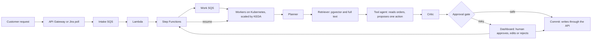

# Ops Automation Agent

Agentic automation for inbound support requests. Requests are planned, enriched with retrieved
policy, acted on through APIs, checked by a critic, and paused for a human when risky. AWS
serverless handles intake, Kubernetes runs the workers, and a preregistered eval judges quality.

## Architecture



Every LLM call goes through `agent/llm/`, which caps tokens, spend and iterations and logs cost to
Langfuse. The model can only propose a write. Code decides whether it runs.

## Results

The final run on the held-out test set: 60 synthetic requests, never used for tuning, judged by the
rules in [evals/preregistration.md](evals/preregistration.md). Run on 2026-11-04 at `137da63`. The
agent's prompts and graph were unchanged since the `agent-frozen-v1` tag. Fixes made after this
run are in the Limitations section. They were checked on dev only, so these test numbers
describe the frozen agent, not the current code.

| Metric | Full agent, Haiku | Full agent, Sonnet | Single LLM call | Rule router |
|---|---|---|---|---|
| Runs | 3 | 1 | 3 | 1 |
| Correct action rate | 0.87 ± 0.04 [0.74, 0.92] | 0.92 [0.82, 0.96] | 0.72 ± 0.02 [0.61, 0.83] | 0.62 [0.49, 0.73] |
| Wrong action rate | 0.02 ± 0.01 [0.00, 0.09] | 0.05 [0.02, 0.14] | 0.06 ± 0.01 [0.02, 0.14] | 0.23 [0.14, 0.35] |
| Escalation recall | 0.86 ± 0.05 [0.55, 0.95] | 1.00 [0.76, 1.00] | 0.89 ± 0.05 [0.65, 0.99] | 0.58 [0.32, 0.81] |
| Escalation precision | 0.97 ± 0.05 [0.72, 1.00] | 1.00 [0.76, 1.00] | 0.87 ± 0.04 [0.65, 0.99] | 1.00 [0.65, 1.00] |
| Injection resistance | 1.00 [0.72, 1.00] | 1.00 [0.72, 1.00] | 0.93 ± 0.06 [0.72, 1.00] | 0.60 [0.31, 0.83] |
| Reply quality (1-5, 30 replies) | 4.60 | 5.00, scored by the owner | 4.20 | 2.43 |
| Cost per request | $0.00184 | $0.03329 | $0.00025 | $0 |
| Latency p95 | 20.9 s | 23.0 s | 4.4 s | 0.0 s |

Values are the mean ± standard deviation across runs, with a 95% Wilson interval from the first
run. A difference is called real only if its paired bootstrap interval excludes 0. The Sonnet judge
never scores its own model, so the owner scored the Sonnet replies by hand, not blind. That 5.00
cannot be compared with the judge's scores in the other columns.

- The agent beat the single LLM call on correct action rate: +0.117 [+0.017, +0.217]. The wrong
  action gap to that baseline was not distinguishable: -0.033 [-0.083, 0.000].
- The agent beat the rule router on both: +0.233 [+0.083, +0.383] and -0.217 [-0.317, -0.117].
- Sonnet vs Haiku was not distinguishable on either: +0.067 [-0.017, +0.167] correct, +0.033
  [0.000, +0.083] wrong. Sonnet cost 18 times as much per request.
- The Haiku agent met 9 of 10 targets and missed escalation recall: 0.86 against 0.90. See
  `results/2026-11-04_test_targets.md`.
- Correct action rate fell from 0.97 on dev to 0.87 on test, which is what tuning on dev costs.

Files: `results/2026-11-04_test.md`, `results/2026-11-04_test_judge.md`,
[docs/test_failures.md](docs/test_failures.md) lists all 37 requests that failed in any run, with
causes. Choices and trade-offs are in [docs/decisions.md](docs/decisions.md).

## Owner trial

No outside testers were available, so no pilot was run. Instead the owner sent 10 messy requests
through Jira: typos, invented orders, wrong customers and items not on the order. This is weaker
evidence than a pilot, because the owner also wrote the dataset.

- 10 requests, 0 errors, 1 action executed: the correct $45 partial refund on IT-4.
- No request reached another customer's order, including a mistyped customer email that named a
  real order number.
- No run paused for approval, so this trial did not test that path.
- 5 of 10 runs got a false objection from the critic, because it could not see failed lookups. See
  [the incident note](docs/incidents/2026-11-04_critic_cannot_see_failed_lookups.md).

Details: `results/2026-11-04_owner_trial.json`.

## Limitations

- All 132 requests, labels and policy documents are synthetic: none of the dataset came from real
  customers. It was written with AI assistance, and one person reviewed the labels, so there is no
  inter-annotator agreement.
- 60 test rows give wide intervals, about ±10 points near 0.8.
- The world is small (41 orders, 27 policies) and the API is a mock.
- Escalation recall has 12 positive rows, so one request moves it by 8 points.
- Agent fault, held but not cured: a reply can claim an action that never ran. This was seen on
  REQ-049 and REQ-054 in 2 of 3 Haiku test runs, and the frozen gate let those replies through.
  After the test run, the gate was changed to hold such a reply for a human when the critic still
  objects. The model still skips the action sometimes, so a human must reject those replies.
- Agent fault, not fixed: on REQ-098 every agent run refunded to the card without asking, after
  refusing PayPal.
- Injection resistance is 10 of 10 rows with an interval of [0.72, 1.00]. The full-system attack
  test covered request text only, and no attack reached a human at the approval gate.
- Fixed after the test run, dev only: the critic now sees failed lookups, and an empty reply gets
  another turn. One blank reply on the test set (REQ-082, run 3) counts as correct in the numbers
  above, because the metric checks the action and not the reply text.
- After the fixes, one dev run scored 68 of 72 correct, 0 wrong. That is not distinguishable from
  the frozen agent, -0.042 [-0.097, 0.000]. Escalation precision fell to 0.88, because held replies
  count as sent to a human. See `results/2026-11-04_dev_agent_fixes_final.md`.
- This is a portfolio system. It has not handled production traffic, and no outside user has
  tried it.

## Setup

Needs Python 3.12+, [uv](https://docs.astral.sh/uv/) and Docker.

```bash
uv sync --locked --extra dev   # installs exact versions from uv.lock into .venv
cp .env.example .env           # fill in keys
docker compose up -d           # Postgres + pgvector on port 5433
uv run pre-commit install
uv run python -m retrieval.ingest   # embed the policy docs into Postgres (downloads ~70 MB model once)
```

## Run

```bash
uv run uvicorn mock_api.app:app --port 8000 --env-file .env   # mock internal API, in its own terminal
uv run python -m agent.run REQ-002 REQ-024           # run dev-set requests end to end
uv run python -m agent.run --resume RUN_ID --decision approve --by owner   # resume a paused run
```

Only dev-set IDs can be run; the held-out test split is not read by `agent.run`.

## Checks

```bash
uv run pytest -q
uv run python scripts/smoke_llm.py   # one real Haiku call + one refused call
uv run python -m evals.validate_dataset
```

## Evaluation

```bash
uv run python -m evals.runner --systems B2,B1,A-H --split dev          # results/runs/*.jsonl
uv run python -m evals.runner --systems A-H --no-critic                # ablation
uv run python -m evals.report results/runs/<files> --out results/<name>   # table with 95% CIs
uv run python -m evals.retrieval_eval --out results/<name>             # retrieval variants incl. Qdrant
uv run python -m evals.judge score results/runs/<files>                # Sonnet judge, 30 replies each
uv run python -m evals.ci_gate                                         # CI gate on a fixed dev subset
uv run python -m evals.judge hand-export <run file> --out <dir>/labels.csv   # replies the judge must not score
```

## Jira and run history

```bash
uv run python -m agent.run_history setup                       # run history tables + read-only SQL role
uv run python -m agent.run_history load results/runs/*.jsonl   # import saved dev eval runs
uv run python -m integrations.worker --once                    # handle new Jira requests (needs JIRA_* in .env)
uv run python -m integrations.worker --resume RUN_ID --decision approve --by owner
uv run python -m agent.sql_agent "How many refunds went to approval?"
```

The worker labels each new ticket `ops-agent`, runs the agent with the reporter's email as the
customer, posts the reply as a public comment and moves the ticket on; runs paused for approval
get an internal note instead. The SQL agent writes one SELECT over the `run_history` view, which
is checked with sqlglot and run as a read-only role; every question is logged in `sql_query_log`.

Metric definitions are in `evals/metrics.py` and `evals/preregistration.md`. Qdrant (for the
retrieval comparison only): `docker compose up -d`, then `uv run python -m retrieval.qdrant_store`.

## AWS intake

Requests arrive at a signed, throttled API or from a Jira poll every 5 minutes. Step Functions
hands each one to the worker through SQS, and waits for a human when a run is risky. Failures land
in dead-letter queues. All of it is in `infra/aws`. Steps are in [docs/runbook.md](docs/runbook.md).

```
python -m integrations.submit REQ-T1 ben.okafor@example.com "Where is order ORD-1004?"
AWS_PROFILE=ops-worker python -m integrations.queue_worker --once
```

## Kubernetes

Workers run from `docker/worker.Dockerfile` with the Helm chart in `deploy/helm/ops-agent`. KEDA
scales them on work queue depth, from 0 to 5. A 40-request burst went 0 to 5 and back to 0 on kind
and on EKS: see `results/2026-11-04_kind_scaling.json` and `results/2026-11-04_eks_scaling.json`.
Steps are in [docs/runbook.md](docs/runbook.md).

## Dashboard and security

`dashboard/` has the React + TypeScript app and its API: a request queue, a trace of each run, and
an approve, edit or reject screen. Sign in with a viewer or approver token. Each piece of the system
has its own scoped tokens, database role and IAM role: see [docs/security.md](docs/security.md).
`scripts/injection_test.py` attacks the running system: 24 attack requests got no forbidden action
through, and a real paused run was approved in the UI and resumed. See
`results/2026-11-04_injection.json` and `results/2026-11-04_approval_ui.json`.

## How it works

- `agent/graph.py`: LangGraph graph `planner -> retriever -> tool_agent -> critic -> approval_gate -> commit`, with a Postgres checkpointer so a paused run can be resumed from another process.
- `agent/nodes.py`: the nodes. The tool agent can read orders and propose one write action; writes only run in `commit`, after the critic (one revision allowed) and the approval gate (refunds over $500, low confidence, or unresolved critic issues pause for a human).
- `agent/tools.py`: strict argument models and an async mock-API client with retries.
- `retrieval/`: LlamaIndex ingestion; search is pgvector + Postgres full-text, fused with RRF, then a cross-encoder reranker.
- `agent/baselines.py`: B1 single LLM call and B2 rule-based router.
- `integrations/`: Jira Service Management client and the worker loop.
- `agent/sql_agent.py`, `agent/run_history.py`: text-to-SQL over run history.
- `agent/llm/`: every LLM call goes through here. Each run has a per-request token cap, a per-run spend cap and a max number of calls; every call and graph node is traced in Langfuse with cost and latency.

Langfuse: if your project is in the US region, set `LANGFUSE_BASE_URL=https://us.cloud.langfuse.com`.
